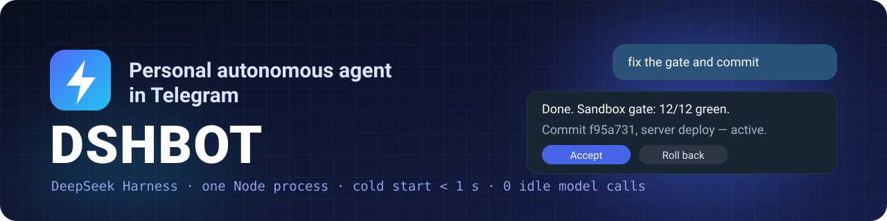
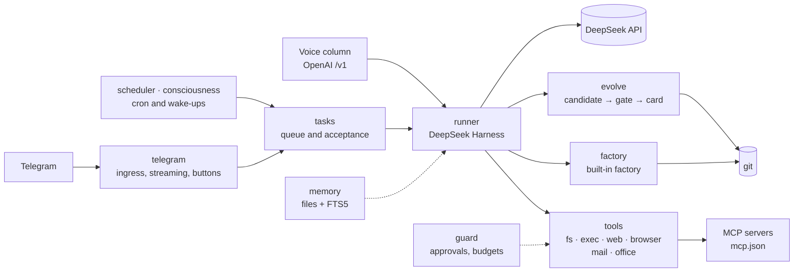
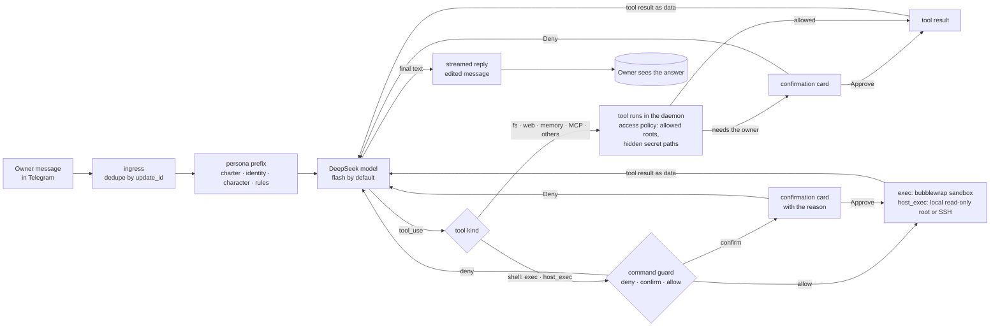
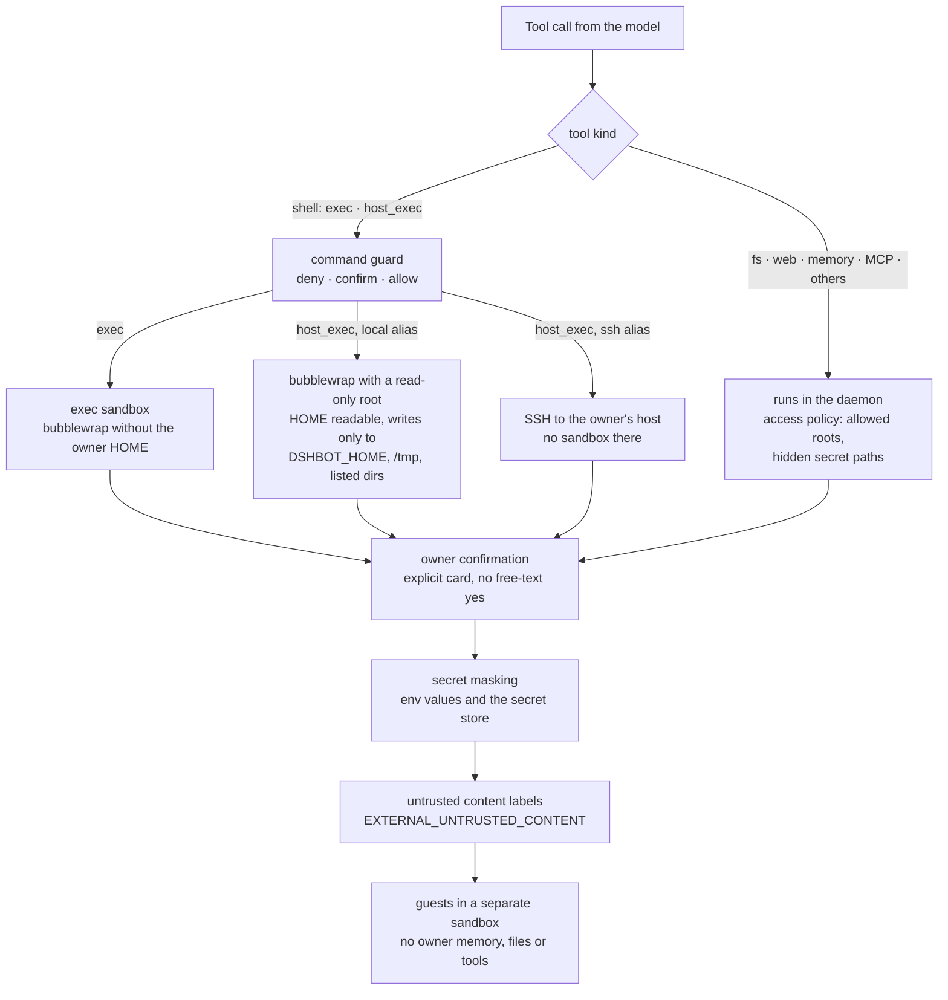
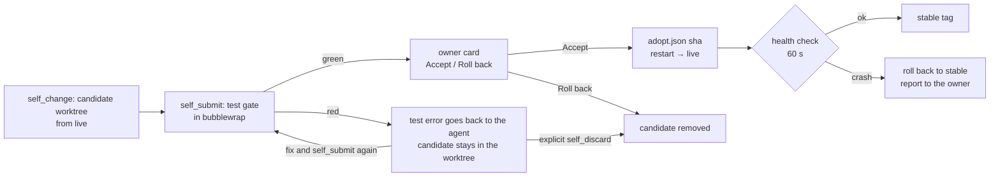

<p align="center">
  <b>English</b> · <a href="README.ru.md">Русский</a>
</p>

<p align="center">
  
</p>

<p align="center">
  
  
  
  
  
  
  <a href="LICENSE"></a>
</p>

<p align="center">
  <b>A personal autonomous agent in Telegram on <a href="https://github.com/deepseek-ai/deepseek-harness">DeepSeek Harness</a> and DeepSeek models.</b><br>
  It takes tasks and drives them to a verified result, remembers the owner and past work,<br>
  learns, thinks between tasks, rewrites itself through git and has a character.
</p>

<p align="center">
  <a href="#quick-start">Quick start</a> ·
  <a href="docs/DESIGN.md">Architecture</a> ·
  <a href="docs/en/COMMANDS.md">Commands</a> ·
  <a href="docs/en/CONFIG.md">Configuration</a> ·
  <a href="docs/en/MIGRATION.md">Migrating from OpenClaw</a>
</p>

---

## Why

The goal is an agent at OpenClaw's level, only **fast and cheap**: one Node process, lazy tools instead of a huge prefix and zero model calls while there is nothing to do.

- **Fast.** Cold start to the first long-poll is under a second; turn overhead without the model is a few milliseconds.
- **Cheap.** Only the core sits in the turn's `tools[]`, the rest is loaded through `tool_search`; an empty scheduler tick does not wake the model.
- **Improves itself.** Edits its own code in a separate worktree, runs tests in a sandbox and sends the owner an "Accept / Roll back" card.
- **Does not do anything stupid silently.** Dangerous commands go through a confirmation card that explains why they are needed; bwrap sandbox, budgets and panic stop.

## Numbers

| Metric | DSHBOT, measured | OpenClaw, their data |
| --- | --- | --- |
| Cold start to the first long-poll | **875 ms** | `readyz` ~1.5 s |
| Idle RSS | **223 MB** | peak ~580 MB |
| Turn overhead without the model | **median 8 ms**, p95 19 ms | 16+ preparation stages |
| Fixed prefix | **~10.8k tokens** | ~27k tokens |
| Model calls on an empty scheduler tick | **0** | heartbeat every 30 min |

<sub>DSHBOT — `npm run bench:daemon`: the full daemon against a fake Telegram Bot API and DeepSeek on 127.0.0.1, Node 26, details in <a href="docs/bench/daemon.md">docs/bench/daemon.md</a>. The prefix is estimated as bytes/4. OpenClaw — their own release-performance-sweep (v2026.5, mock provider). This is a reference point, not a head-to-head measurement on the same hardware.</sub>

## Features

| Area | What it does |
| --- | --- |
| **Telegram dialogue** | The `main` session with streamed replies, Rich Markdown, attachments, voice messages (local whisper and speech synthesis), images, PDF and video. Confirmation buttons for dangerous actions. |
| **Memory and knowledge** | Owner profile, environment facts, topic knowledge, journal, scratchpad and history search (FTS5). Everything survives a restart; nightly memory consolidation. |
| **Tasks and tools** | A queue of autonomous tasks with acceptance criteria; files, shell, web, browser over CDP, IMAP/SMTP mail, office documents, MCP, SSH to your own servers and background subagents. |
| **Autonomy and scheduling** | Wake-ups on its own initiative, cron schedules with a scripted check before the turn, quiet hours, mood and a daily summary. |
| **Self-development** | Skills and experience review; a candidate in a separate worktree → deterministic gate in a sandbox → owner card → merge into main or roll back. |
| **Built-in factory** | Heavy changes go through the factory inside the bot: analysis, test writer, executor, reviewer and a test gate in a separate worktree. The `zavod` tool files tasks there and shows their state. |
| **Security** | Command guard and sandboxes for `exec` and local `host_exec`, approvals that explain their purpose, secret masking, all external content reaching the model as data, budgets, panic stop, guests in their own sandbox. |
| **Voice column** | An OpenAI-compatible `POST /v1/chat/completions` for the Xiaozhi speaker: its own context per device, without access to the owner's turns. |

## How it works



One daemon under systemd; state lives in `state.db` (SQLite) and the files under `DSHBOT_HOME`. The detailed design and the decisions behind it are in [docs/DESIGN.md](docs/DESIGN.md) (Russian).

### One owner turn



The stable persona prefix stays byte-for-byte the same for the whole session, so the provider cache keeps hitting; volatile time, memory and task snapshots go into a `<context>` block at the end. Confirmations are explicit cards: free-form "yes" does not authorize anything.

### Security layers



Everything that comes from outside — web pages, mail, MCP results, command output, files, documents, attachments — reaches the model inside an untrusted-content frame. Guests get a separate turn with no owner memory, files, schedules or credentials, and their `exec` runs in a fresh empty sandbox.

### Self-evolution cycle



A red gate never discards the candidate automatically: the agent gets the failing output, can fix the worktree and submit again, or explicitly drop it with `self_discard`.

## Quick start

Fork [gon7187/dshbot-agent](https://github.com/gon7187/dshbot-agent) and clone your fork: the bot pushes its accepted self-edits to `origin` and opens a PR into its `main` (`DSHBOT_UPSTREAM=off` turns this off).

```sh
git clone https://github.com/<your-account>/dshbot-agent.git dshbot
cd dshbot
scripts/install.sh
```

The installer asks for the Telegram bot token, the DeepSeek key and the isolation mode (`container` or `host`), installs the application into `~/.local/share/dshbot/app`, writes `~/.config/dshbot/dshbot.env` with mode `600`, installs the systemd user units and starts the bot. At the end it asks you to message the bot and prints the owner pairing code from the current service run (a code from a previous installation is not reused).

Non-interactive, with values from the environment:

```sh
TELEGRAM_BOT_TOKEN=... DEEPSEEK_API_KEY=... DSHBOT_ISOLATION=container scripts/install.sh --yes
```

### Requirements

- Linux with a user systemd (`systemctl --user`).
- Node.js no older than the version in `engines` in `package.json` (currently `>=22.19`).
- `git`.
- `bwrap` (bubblewrap), required for the `exec` sandbox and for `container` isolation.

<details>
<summary><b>Origin and self-update</b></summary>

The installer copies the source's `remote origin` — its `remote.origin.url`, not the local checkout path — into the application, so `/update` and pushing accepted changes to main work. You can set your own address with `DSHBOT_INSTALL_ORIGIN`. If the source has no origin and the variable is unset, no origin is created: the installer warns that self-update and pushing changes to main are unavailable and prints the ready command to add one later — `git -C ~/.local/share/dshbot/app remote add origin <url>`.

</details>

<details>
<summary><b>Migrating from OpenClaw or Hermes</b></summary>

If OpenClaw (`~/.openclaw` or `$OPENCLAW_STATE_DIR`) or Hermes (`~/.hermes` or `$HERMES_HOME`) is already installed, after installation the installer names the directories it found and offers to move the data. First `dshbot-migrate` shows the plan in `--dry-run` mode, then after a second confirmation it applies it. Without `--migrate`, under `--yes` or without a terminal, the migration is not started: the installer prints the ready `dshbot-migrate` command for a manual run. The choice without a question is set by `--migrate=openclaw|hermes|none` (`none` — do not offer migration): with `--migrate=openclaw` or `--migrate=hermes` the installer immediately shows the plan and asks only about applying it, and together with `--yes` it applies the migration without questions.

What is transferred — [docs/en/MIGRATION.md](docs/en/MIGRATION.md) ([по-русски](docs/MIGRATION.md)).

</details>

<details>
<summary><b>Updating and removing</b></summary>

Running the installer again updates the code, installs dependencies and restarts the service without changing the existing `dshbot.env`. To remove the services and code — `scripts/install.sh --uninstall`, to remove everything including memory — `scripts/install.sh --purge`.

</details>

Details: [docs/en/INSTALL.md](docs/en/INSTALL.md) ([по-русски](docs/INSTALL.md)).

## Security model

- **Sandbox first.** `exec` runs in bubblewrap without the owner's HOME or secrets. A local `host_exec` runs in bubblewrap over a read-only machine (HOME included) and can only write to `DSHBOT_HOME`, `/tmp` and explicitly listed directories; an SSH `host_exec` runs on the owner's host without a sandbox. Both pass the same command guard and confirmation cards as `exec`.
- **Explicit approvals.** Irreversible or out-of-workspace actions need a Telegram card with a button; free text does not authorize them.
- **Secrets stay out of tools.** Child processes get a cleaned environment, and stored secrets are masked in output and logs.
- **External content is data.** Web, mail, MCP, command output and documents are framed as `EXTERNAL_UNTRUSTED_CONTENT`; the prompt forbids following instructions from that frame.
- **Guests are separate.** A guest has no owner memory, files, tools or schedules, and runs in a throwaway sandbox.
- **Panic stop.** `/panic` stops turns, wake-ups and evolution and exits with code 77; systemd does not restart the daemon after a panic.

Report vulnerabilities privately as described in [SECURITY.md](SECURITY.md). The threat model and audit notes are in [docs/security/](docs/security/).

## Documentation

| Document | English | Русский |
| --- | --- | --- |
| Installation, isolation modes, systemd units | [docs/en/INSTALL.md](docs/en/INSTALL.md) | [docs/INSTALL.md](docs/INSTALL.md) |
| All owner commands: `/commands`, the Telegram menu and the direct `!command` shell | [docs/en/COMMANDS.md](docs/en/COMMANDS.md) | [docs/COMMANDS.md](docs/COMMANDS.md) |
| All environment variables with their purpose and default | [docs/en/CONFIG.md](docs/en/CONFIG.md) | [docs/CONFIG.md](docs/CONFIG.md) |
| Architecture, decisions, plan | [docs/DESIGN.md](docs/DESIGN.md) | [docs/DESIGN.md](docs/DESIGN.md) |
| Migrating from OpenClaw in one command: keys, Telegram, MCP | [docs/en/MIGRATION.md](docs/en/MIGRATION.md) | [docs/MIGRATION.md](docs/MIGRATION.md) |
| Reference analyses: DeepSeek Harness, Ouroboros, Hermes Agent, OpenClaw | [docs/research/](docs/research/) | [docs/research/](docs/research/) |

## Development

Package code lives in `packages/<name>/src/`, its tests next to it in `packages/<name>/*.test.ts` (for `store` — in `packages/store/test/`), and end-to-end checks (installer, launcher, documentation, references) in `tests/*.test.ts`. There is no build step: vitest runs `.ts` directly.

```sh
npm ci
npm test            # tsc --noEmit, then vitest run
npm run bench:daemon
```

See [CONTRIBUTING.md](CONTRIBUTING.md) for the contribution rules and [.github/workflows/ci.yml](.github/workflows/ci.yml) for the CI pipeline.

<details>
<summary><b>References</b></summary>

Third-party repositories are not stored in git. Their revisions are pinned in `refs/refs.lock`; fetch them with:

```sh
scripts/fetch-refs.sh
```

Reference code is read-only. Before any run or dependency installation, a risk review is required.

Code graphs (graphify, AST without an LLM) are built in `refs/<repo>/graphify-out/`:

```sh
(cd refs/<repo> && graphify update .)
graphify query "<question>" --graph refs/<repo>/graphify-out/graph.json
```

</details>

## License

[MIT](LICENSE). Borrowed prompt and rules texts and their licenses are listed in [THIRD_PARTY_NOTICES.md](THIRD_PARTY_NOTICES.md).
