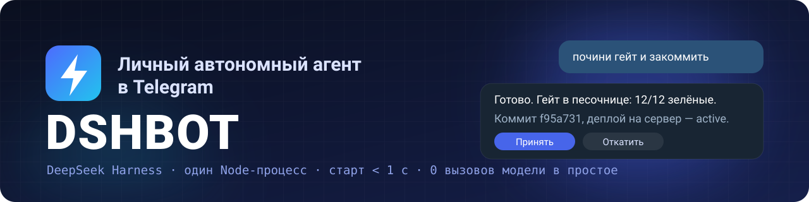
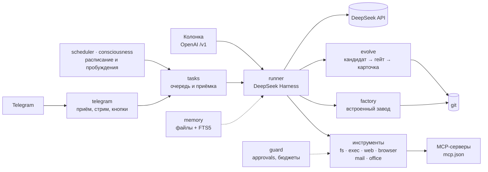
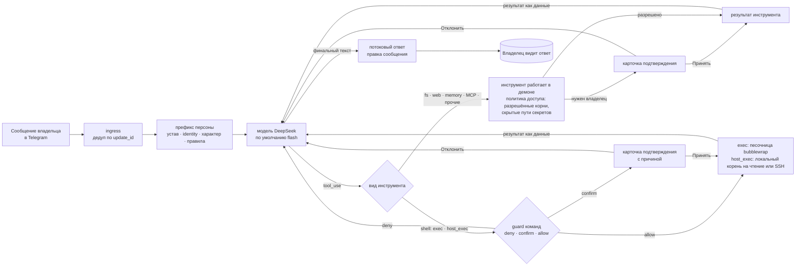
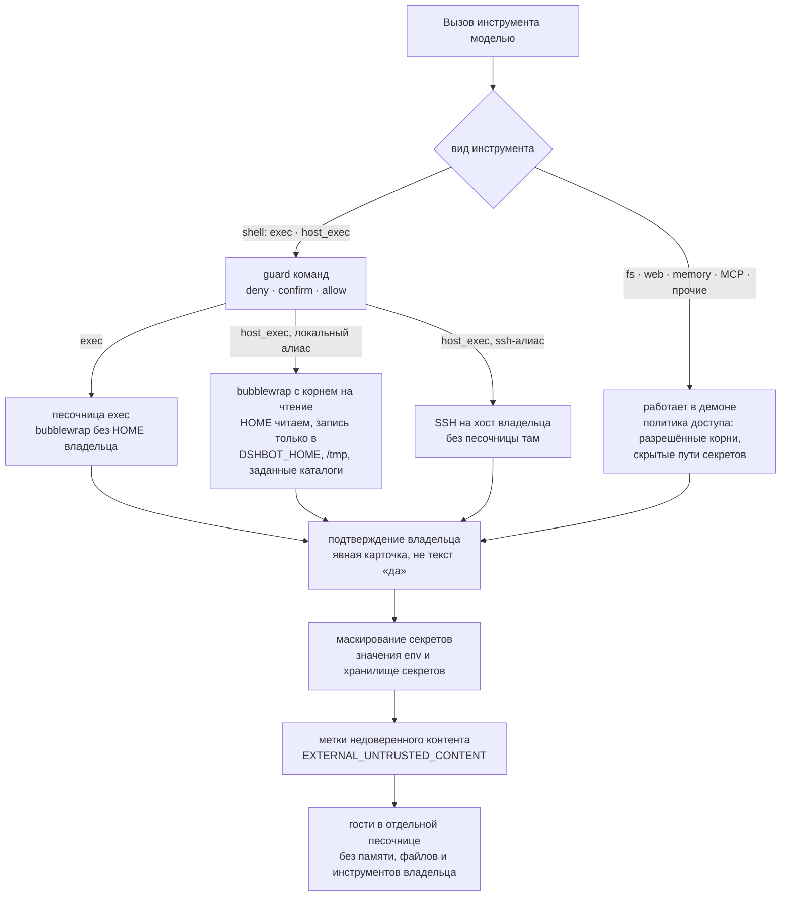
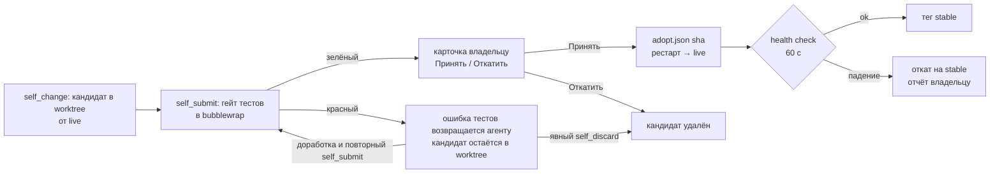

<p align="center">
  <a href="README.md">English</a> · <b>Русский</b>
</p>

<p align="center">
  
</p>

<p align="center">
  
  
  
  
  
  
  <a href="LICENSE"></a>
</p>

<p align="center">
  <b>Личный автономный агент в Telegram на <a href="https://github.com/deepseek-ai/deepseek-harness">DeepSeek Harness</a> и моделях DeepSeek.</b><br>
  Берёт задачи и доводит их до проверенного результата, помнит владельца и прошлую работу,<br>
  учится, думает между задачами, переписывает себя через git и имеет характер.
</p>

<p align="center">
  <a href="#быстрый-старт">Быстрый старт</a> ·
  <a href="docs/DESIGN.md">Архитектура</a> ·
  <a href="docs/COMMANDS.md">Команды</a> ·
  <a href="docs/CONFIG.md">Настройки</a> ·
  <a href="docs/MIGRATION.md">Переезд с OpenClaw</a>
</p>

---

## Зачем

Цель — агент уровня OpenClaw, только **быстрый и дешёвый**: один Node-процесс, ленивые инструменты вместо гигантского префикса и ни одного вызова модели, пока делать нечего.

- **Быстрый.** Холодный старт до первого long-poll — меньше секунды, накладные хода без модели — единицы миллисекунд.
- **Дешёвый.** В `tools[]` хода только ядро, остальные инструменты подгружаются через `tool_search`; пустой тик расписания модель не будит.
- **Сам себя улучшает.** Правит свой код в отдельном worktree, гоняет тесты в песочнице и присылает владельцу карточку «Принять / Откатить».
- **Не делает глупостей молча.** Опасные команды — только через карточку подтверждения с объяснением, зачем она нужна; песочница bwrap, бюджеты и panic-остановка.

## Цифры

| Метрика | DSHBOT, замер | OpenClaw, их данные |
| --- | --- | --- |
| Холодный старт до первого long-poll | **875 мс** | `readyz` ~1,5 с |
| RSS в простое | **223 МБ** | пик ~580 МБ |
| Накладные хода без модели | **медиана 8 мс**, p95 19 мс | 16+ стадий подготовки |
| Фиксированный префикс | **~10,8k токенов** | ~27k токенов |
| Вызовы модели на пустом тике расписания | **0** | heartbeat раз в 30 мин |

<sub>DSHBOT — `npm run bench:daemon`: полный демон против фейковых Telegram Bot API и DeepSeek на 127.0.0.1, Node 26, подробности в <a href="docs/bench/daemon.md">docs/bench/daemon.md</a>. Префикс оценён как байты/4. OpenClaw — их собственный release-performance-sweep (v2026.5, mock-провайдер). Это ориентир, а не замер лоб в лоб на одном железе.</sub>

## Возможности

| Область | Что умеет |
| --- | --- |
| **Диалог в Telegram** | Основная сессия `main` с потоковым ответом, Rich Markdown, вложениями, голосовыми (локальный whisper и синтез речи), картинками, PDF и видео. Кнопки подтверждения опасных действий. |
| **Память и знания** | Профиль владельца, факты окружения, знания по темам, журнал, блокнот и поиск по истории (FTS5). Всё переживает перезапуск; ночная консолидация памяти. |
| **Задачи и инструменты** | Очередь автономных задач с критериями приёмки; файлы, shell, web, браузер по CDP, почта IMAP/SMTP, офисные документы, MCP, SSH к своим серверам и фоновые субагенты. |
| **Автономность и расписание** | Пробуждения по собственной инициативе, cron-расписания со скриптовой проверкой перед ходом, тихие часы, настроение и сводка дня. |
| **Саморазвитие** | Навыки и ревью опыта; кандидат в отдельном worktree → детерминированный гейт в песочнице → карточка владельцу → вливание в main или откат. |
| **Встроенный завод** | Тяжёлые изменения идут через завод внутри бота: разбор, тестописец, исполнитель, ревьюер и гейт тестов в отдельном worktree. Инструмент `zavod` ставит туда задачи и показывает их состояние. |
| **Безопасность** | Guard команд и песочницы для `exec` и локального `host_exec`, approvals с объяснением цели, маскирование секретов, весь внешний контент приходит модели как данные, бюджеты, panic-остановка, гости в своей песочнице. |
| **Голосовая колонка** | OpenAI-совместимый `POST /v1/chat/completions` для колонки Xiaozhi: свой контекст на устройство, без доступа к ходам владельца. |

## Как устроено



Один демон под systemd, состояние — в `state.db` (SQLite) и файлах `DSHBOT_HOME`. Подробная схема и решения — в [docs/DESIGN.md](docs/DESIGN.md).

### Путь одного хода владельца



Стабильный префикс персоны не меняется ни на байт всю сессию, поэтому кэш провайдера продолжает попадать; изменчивые время, память и снимок задач идут блоком `<context>` в конце. Подтверждения — только явные карточки: свободное «да» ничего не разрешает.

### Слои безопасности



Всё, что приходит извне — веб-страницы, почта, результаты MCP, вывод команд, файлы, документы, вложения — попадает к модели внутри рамки недоверенного контента. Гость получает отдельный ход без памяти владельца, файлов, расписаний и ключей, а его `exec` идёт в новом пустом bwrap.

### Цикл самоизменения evolve



Красный гейт ничего не отбрасывает автоматически: агент получает хвост падения, может доработать worktree и отправить его снова либо явно убрать кандидата через `self_discard`.

## Быстрый старт

Сделайте форк [gon7187/dshbot-agent](https://github.com/gon7187/dshbot-agent) и клонируйте его: принятые самоправки бот пушит в `origin` и открывает PR в его `main` (`DSHBOT_UPSTREAM=off` это выключает).

```sh
git clone https://github.com/<ваш-аккаунт>/dshbot-agent.git dshbot
cd dshbot
scripts/install.sh
```

Установщик спросит токен бота Telegram, ключ DeepSeek и режим изоляции (`container` или `host`), поставит приложение в `~/.local/share/dshbot/app`, запишет `~/.config/dshbot/dshbot.env` с правами `600`, поставит пользовательские службы systemd и запустит бота. В конце он попросит написать боту в личку и покажет код привязки владельца из журнала текущего запуска службы (код прошлой установки не подхватывается).

Без вопросов, значения из окружения:

```sh
TELEGRAM_BOT_TOKEN=... DEEPSEEK_API_KEY=... DSHBOT_ISOLATION=container scripts/install.sh --yes
```

### Что нужно

- Linux с пользовательским systemd (`systemctl --user`).
- Node.js не ниже версии из `engines` в `package.json` (сейчас `>=22.19`).
- `git`.
- `bwrap` (bubblewrap) — обязателен для песочницы `exec` и режима изоляции `container`.

<details>
<summary><b>Origin и самообновление</b></summary>

Установщик переносит в приложение `remote origin` источника — адрес его `remote.origin.url`, а не локальный путь к checkout, — чтобы работали `/update` и отправка принятых правок в main. Свой адрес можно задать переменной `DSHBOT_INSTALL_ORIGIN`. Если у источника origin нет и переменная не задана, origin не создаётся: установщик предупредит, что самообновление и отправка правок в main недоступны, и покажет готовую команду добавления позже — `git -C ~/.local/share/dshbot/app remote add origin <адрес>`.

</details>

<details>
<summary><b>Переезд с OpenClaw или Hermes</b></summary>

Если уже установлен OpenClaw (`~/.openclaw` или `$OPENCLAW_STATE_DIR`) или Hermes (`~/.hermes` или `$HERMES_HOME`), после установки установщик называет найденные каталоги и предлагает перенести данные. Сначала `dshbot-migrate` показывает план в режиме `--dry-run`, затем после второго подтверждения применяет его. Без `--migrate` при `--yes` или без терминала миграция не запускается: установщик печатает готовую команду `dshbot-migrate` для ручного запуска. Выбор без вопроса задаёт `--migrate=openclaw|hermes|none` (`none` — не предлагать миграцию): с `--migrate=openclaw` или `--migrate=hermes` установщик сразу показывает план и спрашивает только о применении, а вместе с `--yes` применяет миграцию без вопросов.

Что переносится — [docs/MIGRATION.md](docs/MIGRATION.md) ([in English](docs/en/MIGRATION.md)).

</details>

<details>
<summary><b>Обновление и удаление</b></summary>

Повторный запуск обновляет код, ставит зависимости и перезапускает службу, не меняя существующий `dshbot.env`. Удаление служб и кода — `scripts/install.sh --uninstall`, полное удаление с памятью — `scripts/install.sh --purge`.

</details>

Подробности: [docs/INSTALL.md](docs/INSTALL.md) ([in English](docs/en/INSTALL.md)).

## Модель безопасности

- **Сначала песочница.** `exec` идёт в bubblewrap без HOME владельца и секретов. Локальный `host_exec` идёт в bubblewrap поверх машины только на чтение (HOME тоже читаем) и может писать только в `DSHBOT_HOME`, `/tmp` и явно перечисленные каталоги; `host_exec` по SSH выполняется на хосте владельца без песочницы. Оба проходят тот же guard команд и карточки подтверждения, что и `exec`.
- **Явные подтверждения.** Необратимые действия и действия вне workspace требуют карточки в Telegram с кнопкой; свободный текст их не разрешает.
- **Секреты не попадают в инструменты.** Дочерние процессы получают очищенное окружение, а сохранённые секреты маскируются в выводе и журналах.
- **Внешний контент — это данные.** Web, почта, MCP, вывод команд и документы приходят в рамке `EXTERNAL_UNTRUSTED_CONTENT`; промпт запрещает исполнять инструкции из неё.
- **Гости отдельно.** У гостя нет памяти владельца, файлов, инструментов и расписаний, а работает он в одноразовой песочнице.
- **Panic-остановка.** `/panic` останавливает ходы, пробуждения и эволюцию и завершает процесс кодом 77; после паники systemd не перезапускает демон.

Об уязвимостях сообщайте приватно, как описано в [SECURITY.md](SECURITY.md). Модель угроз и аудит — в [docs/security/](docs/security/).

## Документация

| Документ | English | Русский |
| --- | --- | --- |
| Установка, режимы изоляции, службы systemd | [docs/en/INSTALL.md](docs/en/INSTALL.md) | [docs/INSTALL.md](docs/INSTALL.md) |
| Все команды владельца: `/команды`, меню Telegram и прямой shell `!команда` | [docs/en/COMMANDS.md](docs/en/COMMANDS.md) | [docs/COMMANDS.md](docs/COMMANDS.md) |
| Все переменные окружения с назначением и значением по умолчанию | [docs/en/CONFIG.md](docs/en/CONFIG.md) | [docs/CONFIG.md](docs/CONFIG.md) |
| Архитектура, решения, план | [docs/DESIGN.md](docs/DESIGN.md) | [docs/DESIGN.md](docs/DESIGN.md) |
| Переезд с OpenClaw одной командой: ключи, Telegram, MCP | [docs/en/MIGRATION.md](docs/en/MIGRATION.md) | [docs/MIGRATION.md](docs/MIGRATION.md) |
| Разборы референсов: DeepSeek Harness, Ouroboros, Hermes Agent, OpenClaw | [docs/research/](docs/research/) | [docs/research/](docs/research/) |

## Разработка

Код пакета живёт в `packages/<имя>/src/`, его тесты — рядом, в `packages/<имя>/*.test.ts` (у `store` — в `packages/store/test/`), а сквозные проверки (установщик, лаунчер, документация, референсы) — в `tests/*.test.ts`. Сборки нет: vitest исполняет `.ts` напрямую.

```sh
npm ci
npm test            # tsc --noEmit, затем vitest run
npm run bench:daemon
```

Правила участия — в [CONTRIBUTING.md](CONTRIBUTING.md), конвейер CI — в [.github/workflows/ci.yml](.github/workflows/ci.yml).

<details>
<summary><b>Референсы</b></summary>

Чужие репозитории не хранятся в git. Их ревизии зафиксированы в `refs/refs.lock`, стянуть:

```sh
scripts/fetch-refs.sh
```

Код референсов только читается. Перед любым запуском или установкой зависимостей нужна проверка риска.

Графы кода (graphify, AST без LLM) строятся в `refs/<repo>/graphify-out/`:

```sh
(cd refs/<repo> && graphify update .)
graphify query "<вопрос>" --graph refs/<repo>/graphify-out/graph.json
```

</details>

## Лицензия

[MIT](LICENSE). Заимствованные тексты промптов и правил и их лицензии — в [THIRD_PARTY_NOTICES.md](THIRD_PARTY_NOTICES.md).
